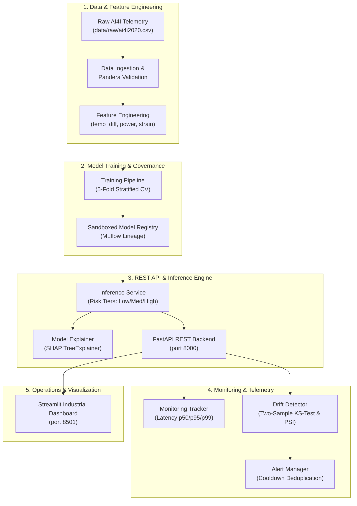

# SentinelPM — Industrial Predictive Maintenance Platform

[](https://github.com/Kartheekputti/SentinelPM/actions/workflows/ci.yml)
[](https://www.python.org/downloads/release/python-3110/)
[](https://fastapi.tiangolo.com)
[](https://streamlit.io)
[](https://github.com/astral-sh/ruff)
[](https://opensource.org/licenses/MIT)

SentinelPM is a production-style, modular machine learning platform designed to predict industrial machine failures, quantify operational risk, explain decisions via SHAP attribution, and monitor sensor telemetry drift in real time.

---

## 1. Project Overview

Modern manufacturing facilities operate rotating machinery (milling machines, lathes, spindles) under harsh mechanical and thermal stresses. Unplanned machine failures cause costly assembly line stoppages, tool wreckage, and worker safety risks.

SentinelPM provides an end-to-end predictive maintenance solution built as a **modular monolith**:
- **Reproducible Data Engineering:** Automated ingestion and Pandera schema validation.
- **Physical Feature Engineering:** Convective thermal dissipation, mechanical spindle power, and wear-strain interactions.
- **Champion Model Evaluation:** Imbalanced learning evaluated via Stratified 5-Fold Cross-Validation, with optimal decision thresholds.
- **Explainability:** SHAP TreeExplainer delivering signed feature attributions and diagnostic narratives.
- **Production REST API:** High-throughput FastAPI backend with request tracing and model sandboxing.
- **Industrial Dashboard:** Multi-page Streamlit interface for fleet health, interactive scoring, and batch CSV reports.
- **Operational Governance:** Two-sample Kolmogorov-Smirnov continuous sensor drift, Population Stability Index (PSI), and cooldown alert deduplication.

---

## 2. Problem Statement

Industrial predictive maintenance requires balancing two competing operational hazards:
1. **Missed Failures (False Negatives):** High severity. A broken tool or seized bearing damages finished workpieces and causes catastrophic unplanned downtime ($10,000+ / hour).
2. **False Alarms (False Positives):** Moderate severity. Halting a functioning machine for unnecessary inspection wastes technician hours and reduces overall factory throughput.

Given an extreme class imbalance (~3.39% failure rate), **Accuracy is a misleading metric**. A trivial baseline predicting "No Failure" achieves 96.6% accuracy while missing 100% of equipment breakdowns. SentinelPM optimizes for **PR-AUC (Average Precision)** and **Recall**, calibrating decision thresholds to catch critical failures while bounding false alarm rates.

---

## 3. Architecture Diagram

SentinelPM avoids premature microservice complexity, using clean domain boundaries within a single deployable codebase:



For detailed architectural trade-offs, see [docs/architecture.md](docs/architecture.md).

---

## 4. Technology Stack

- **Core & Runtime:** Python 3.11, NumPy 1.26+, pandas 2.0+
- **Machine Learning:** scikit-learn 1.4+, XGBoost 2.0+
- **Explainability:** SHAP 0.45+ (TreeExplainer)
- **Experiment Tracking:** MLflow 2.12+ (local file store with CloudPickle serialization)
- **Data Validation & Typing:** Pandera 0.20+, Pydantic 2.6+
- **API & Serving:** FastAPI 0.110+, Uvicorn 0.29+, httpx 0.27+
- **Interactive Dashboard:** Streamlit 1.32+, Altair 5.0+
- **Statistics & Drift:** SciPy 1.12+ (two-sample KS-test, PSI)
- **Testing & Code Quality:** pytest 8.0+, pytest-cov 5.0+, Ruff 0.6+
- **Containerization & CI:** Docker, Docker Compose v2, GitHub Actions

---

## 5. Dataset Source and Limitations

SentinelPM utilizes the **AI4I 2020 Predictive Maintenance Dataset** from the UCI Machine Learning Repository:
- **UCI Reference:** [https://archive.ics.uci.edu/dataset/601/ai4i+2020+predictive+maintenance+dataset](https://archive.ics.uci.edu/dataset/601/ai4i+2020+predictive+maintenance+dataset)
- **Direct Download:** [https://archive.ics.uci.edu/static/public/601/ai4i+2020+predictive+maintenance+dataset.zip](https://archive.ics.uci.edu/static/public/601/ai4i+2020+predictive+maintenance+dataset.zip)

The dataset contains 10,000 machine observations with features:
- `Air temperature [K]`, `Process temperature [K]`, `Rotational speed [rpm]`, `Torque [Nm]`, `Tool wear [min]`, `Type` (L/M/H), and `Machine failure`.

> [!WARNING]
> **Simulated Dataset Notice:** The AI4I 2020 dataset is a **synthetic / simulated dataset**, not live factory telemetry. It is designed for methodological benchmarking and architectural validation. Do not connect SentinelPM directly to physical machine controllers, emergency stop circuits, or industrial safety interlocks.

---

## 6. Repository Structure

```
sentinelpm/
├── app/
│   ├── api/            # FastAPI REST backend, routes, and tracing middleware
│   ├── core/           # Configuration, structured logging, and typed exceptions
│   ├── dashboard/      # Streamlit industrial dashboard (pages, widgets, client)
│   ├── data/           # CSV loading, validation schemas, and Pandera contracts
│   ├── explainability/ # SHAP TreeExplainer, attribution narrative, and reports
│   ├── features/       # Scikit-learn compatible feature transformers
│   ├── inference/      # Deterministic inference service and risk tiers
│   ├── monitoring/     # Telemetry tracking, KS-test/PSI drift, and alert rules
│   ├── registry/       # Sandboxed model registry and MLflow tracking
│   └── training/       # Stratified cross-validation pipeline & tuning
├── artifacts/          # Trained model weights and evaluation reports (not committed)
├── configs/            # Pipeline, experiment, and monitoring configurations
├── data/raw/           # Local source datasets (not committed)
├── docs/               # System architecture, API specs, benchmarks, and release
├── scripts/            # Executable CLI workflows (train, api, dashboard, smoke_test)
├── tests/              # Comprehensive unit and integration test suites
├── .github/workflows/  # GitHub Actions CI workflow
├── docker-compose.yml  # Multi-service container orchestration
├── Dockerfile          # Multi-target unprivileged container image
├── pyproject.toml      # Project packaging and tool configuration
└── requirements.txt    # Frozen dependency specifications
```

---

## 7. Installation Instructions

```powershell
# 1. Clone repository
git clone https://github.com/Kartheekputti/SentinelPM.git
cd SentinelPM

# 2. Create and activate a clean virtual environment (Python 3.11+)
py -3.11 -m venv .venv
.venv\Scripts\Activate.ps1

# 3. Install project in editable mode with development tooling
pip install -r requirements.txt
pip install -e ".[dev]"
```

---

## 8. Environment Configuration

Configuration is automatically loaded from environment variables with built-in fallbacks. To customize, copy `.env.example` to `.env`:

```powershell
cp .env.example .env
```

| Variable | Default | Purpose |
| --- | --- | --- |
| `SENTINELPM_ENVIRONMENT` | `dev` | Active environment (`dev`, `test`, `prod`) |
| `SENTINELPM_LOG_LEVEL` | `INFO` | Console logging verbosity (`DEBUG`, `INFO`, `WARNING`) |
| `SENTINELPM_RANDOM_SEED` | `42` | Global reproducibility seed |
| `SENTINELPM_API_PORT` | `8000` | FastAPI server port |
| `SENTINELPM_ACTIVE_MODEL` | `random_forest` | Active champion model (`random_forest`, `xgboost`) |
| `SENTINELPM_API_URL` | `http://127.0.0.1:8000` | Base URL used by Streamlit to reach FastAPI |
| `SENTINELPM_DASHBOARD_PORT`| `8501` | Streamlit dashboard port |
| `SENTINELPM_DRIFT_KS_ALPHA`| `0.05` | Alpha threshold for continuous KS-test drift |
| `SENTINELPM_DRIFT_PSI_THRESHOLD` | `0.25` | Population Stability Index significant drift threshold |
| `SENTINELPM_ALERT_LATENCY_P95_MS` | `250.0` | SLA p95 latency threshold in milliseconds |

---

## 9. Training Commands

Download the raw dataset and run the training pipeline:

```powershell
# 1. Download AI4I dataset (if not already present in data/raw/)
python scripts/download_dataset.py

# 2. Run data validation and generate quality summary
python -m scripts.validate_dataset

# 3. Execute exploratory data analysis
python -m scripts.run_eda

# 4. Train baseline, Logistic Regression, Random Forest, and XGBoost
python -m scripts.train
```

Trained models and cross-validation reports are serialized to `artifacts/models/`.

---

## 10. Model Evaluation Methodology

Models are evaluated via **5-fold Stratified Cross-Validation** on training folds, preserving an independent held-out test set (20%, 2,000 samples).

### Candidate Model Comparison (5-Fold Stratified CV)

| Model Candidate | PR-AUC (Average Precision) | Optimal Threshold | Decision Strategy |
| --- | --- | --- | --- |
| **Dummy Baseline** | 0.0339 | 0.01 | Uniform prior prediction |
| **Logistic Regression** | 0.4930 | 0.87 | Linear baseline with standard scaling |
| **XGBoost Classifier** | 0.8628 | 0.83 | Gradient boosted decision trees |
| **Random Forest (Champion)** | **0.8740** | **0.31** | **Balanced class-weighted ensemble** |

The **Random Forest** achieved the highest PR-AUC (**0.8740**) and was selected as the active production model. Its calibrated decision threshold of **0.31** optimizes failure detection while controlling false alarms.

---

## 11. API Endpoint Documentation

Start the REST API server:

```powershell
python -m scripts.run_api
```

Once running, interactive OpenAPI documentation is available at [http://127.0.0.1:8000/docs](http://127.0.0.1:8000/docs).

| Method | Endpoint | Description |
| --- | --- | --- |
| `GET` | `/health` | Liveness probe returning process status and timestamp. |
| `GET` | `/ready` | Readiness probe verifying loaded model weights in memory. |
| `GET` | `/model/info` | Non-sensitive model version, threshold, and feature schema. |
| `POST` | `/predict` | Single machine sensor telemetry risk prediction. |
| `POST` | `/predict/batch`| High-throughput batch inference (up to 500 records). |
| `POST` | `/explain` | On-demand SHAP attribution breakdown and narrative summary. |
| `GET` | `/monitoring/summary` | Real-time SLA latency (p50/p95/p99), drift tests, and alerts. |

For detailed payloads and curl examples, see [docs/api.md](docs/api.md).

---

## 12. Dashboard Startup Instructions

Launch the multi-page Streamlit dashboard:

```powershell
# Using the CLI launcher script
python -m scripts.run_dashboard

# Or directly using Streamlit
streamlit run app/dashboard/app.py --server.port 8501
```

Access the dashboard at [http://localhost:8501](http://localhost:8501).

### Dashboard Pages
1. **Overview:** Fleet analyzed count, high-risk ratios, serving status, and API health.
2. **Single Prediction:** Interactive sensor parameter sliders, bounds validation, and instant SHAP chart.
3. **Batch Prediction:** CSV telemetry drag-and-drop, automated schema validation, and downloadable report.
4. **Explainability:** Global mean absolute SHAP rankings and interactive single-observation waterfalls.
5. **Monitoring:** Real-time request SLA percentiles, two-sample KS-test drift, and active alert logs.
6. **Model Info:** Hyperparameters, benchmark comparisons, decision thresholds, and serving state.

---

## 13. Docker Deployment Instructions

Deploy both services with a single command using Docker Compose:

```bash
# 1. Build unified production image
docker compose build

# 2. Start API and Dashboard in background
docker compose up -d

# 3. Check container status
docker compose ps

# 4. View real-time logs
docker compose logs -f

# 5. Teardown
docker compose down
```

For container security hardening, see [docs/deployment.md](docs/deployment.md).

---

## 14. Testing Instructions

SentinelPM maintains 100% test pass rate across unit, integration, and end-to-end suites:

```powershell
# Run the complete test suite (230+ tests)
pytest

# Run tests with terminal coverage report
pytest --cov=app --cov-report=term-missing

# Run code style & formatting checks
ruff check .
ruff format --check .

# Run the end-to-end system smoke test
python -m scripts.smoke_test
```

---

## 15. Example Prediction Request & Response

### Request (`POST /predict`)

```bash
curl -X POST http://127.0.0.1:8000/predict \
  -H "Content-Type: application/json" \
  -d '{
    "Type": "L",
    "Air_temperature_K": 302.1,
    "Process_temperature_K": 311.0,
    "Rotational_speed_rpm": 1300,
    "Torque_Nm": 65.0,
    "Tool_wear_min": 220
  }'
```

### Response (`200 OK`)

```json
{
  "prediction_id": "8f3b2a1c-9e2d-4f1a-b3c4-123456789abc",
  "model_version": "1.0.0",
  "model_name": "random_forest",
  "predicted_failure": true,
  "failure_probability": 0.884,
  "risk_level": "high",
  "threshold_applied": 0.31,
  "timestamp": "2026-10-22T07:15:00.000000+00:00"
}
```

---

## 16. Monitoring and Drift Methodology

SentinelPM's monitoring subsystem (`app/monitoring/`) executes automated statistical tests against baseline telemetry:

1. **Continuous Sensor Drift (Two-Sample Kolmogorov-Smirnov Test):**
   - Evaluates whether serving distributions for `Air_temperature_K`, `Process_temperature_K`, `Rotational_speed_rpm`, `Torque_Nm`, and `Tool_wear_min` diverge from training baselines.
   - Triggers drift when the two-sided p-value drops below $\alpha = 0.05$.
2. **Categorical Drift (Population Stability Index - PSI):**
   - Evaluates machine variant distribution (`Type`: L/M/H):
     - $\text{PSI} < 0.10$: Stable fleet distribution.
     - $0.10 \le \text{PSI} < 0.25$: Moderate distribution shift.
     - $\text{PSI} \ge 0.25$: Significant shift (triggers alert for investigation).
3. **Alert Deduplication:** Cooldown windows (default: 300s) prevent alert storms during prolonged drift episodes.

---

## 17. Limitations and Future Enhancements

### Current System Limitations
- **Simulated Data:** Models are trained on AI4I synthetic data. Real-world machine telemetry contains vibration spectra, acoustic emissions, and environmental noise not captured in AI4I.
- **In-Memory Telemetry:** The operational monitoring tracker currently stores metrics in memory; restarts reset runtime counters.
- **Single Node:** Designed as a modular monolith for single-server or single-container deployment.

### Future Roadmap
- **Vibration & High-Frequency Telemetry:** Ingest raw accelerometer time-series with FFT spectral analysis.
- **Persistent Metric Store:** Integrate Prometheus and Grafana for historical metric storage.
- **Continuous Online Retraining:** Automated pipeline triggering upon validated concept drift.

---

## 18. Empirical Performance Benchmarks

Measured on Windows 10 (64-bit), Python 3.11.9, Intel x86_64:

| Metric | Measured Value | Target SLA | Status |
| --- | --- | --- | --- |
| **Application Bootstrap Time** | `1.0 ms` | < 1,000 ms | PASS |
| **Model Memory Warmup** | `184.1 ms` | < 500 ms | PASS |
| **Mean Single Prediction Latency** | `54.9 ms` | < 100 ms | PASS |
| **Median Prediction Latency (p50)** | `54.6 ms` | < 100 ms | PASS |
| **95th Percentile Latency (p95)** | `57.9 ms` | < 250 ms | PASS |
| **Batch Throughput (500 records)** | **`6,307 records / sec`** | > 500 rec/s | PASS |
| **Error Rate Under Load** | **`0.0%`** | < 0.1% | PASS |

For complete benchmark records, see [docs/benchmarks.md](docs/benchmarks.md).
