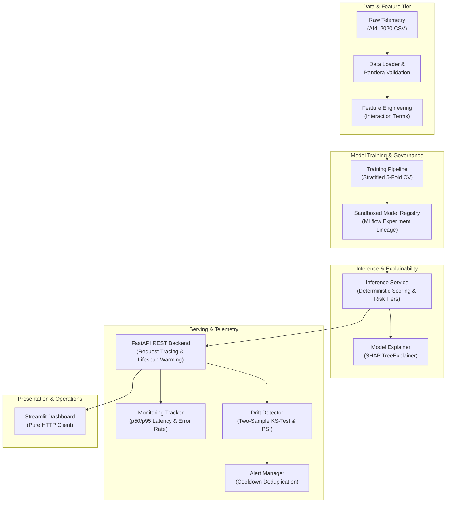

# SentinelPM — System Architecture Specification

## 1. Architectural Philosophy: The Modular Monolith

SentinelPM is architected as a **modular monolith**. Rather than fragmenting the application across unneeded microservices, databases, or cloud infrastructure, SentinelPM organizes cohesive domain components into strictly separated Python packages within a single deployable repository.

---

## 2. Component Structure & Responsibilities

| Subsystem | Package Path | Primary Responsibility | Isolation Guarantee |
| --- | --- | --- | --- |
| **Foundation & Core** | `app/core/` | Global configuration, structured logging, and typed domain exceptions. | Zero external business dependencies. |
| **Data Ingestion** | `app/data/` | CSV loading, missing value detection, and Pandera schema validation. | Never mutates raw source files; raises typed `DataValidationError`. |
| **Feature Engineering** | `app/features/` | Scikit-learn compatible transformers (`temp_diff`, `mechanical_power`, `strain`). | Fits only on training splits; strictly strips forbidden target columns. |
| **Model Training** | `app/training/` | Stratified cross-validation, hyperparameter tuning, and threshold selection. | Test split remains held-out; PR-AUC is primary metric for imbalanced data. |
| **Model Registry** | `app/registry/` | Local MLflow experiment tracking, CloudPickle model serialization. | Path traversal sandboxing prevents unauthorized model loading. |
| **Inference Engine** | `app/inference/` | Single and batch scoring with 3-tier risk classification. | Input validation strictly rejects `Machine failure` and failure indicators. |
| **Explainability** | `app/explainability/` | SHAP TreeExplainer attributions, risk driver narratives. | Explicitly includes causality disclaimer on all outputs. |
| **REST API** | `app/api/` | REST endpoints, dependency injection, and `X-Request-ID` tracing. | Stateless request lifecycle; standardized JSON error envelopes. |
| **Monitoring** | `app/monitoring/` | In-memory operational metrics, KS-test and PSI drift detection, alerts. | Decoupled from serving path; alert cooldowns prevent notification storms. |
| **Dashboard** | `app/dashboard/` | Multi-page Streamlit industrial monitoring interface. | Communicates purely over HTTP; never imports model weights directly. |

---

## 3. Strict Anti-Leakage Architecture

Machine learning pipelines in predictive maintenance frequently suffer from subtle target leakage. SentinelPM enforces **three independent defense barriers**:

1. **Schema-Level Rejection (`SensorRecord`):** The Pydantic model uses a pre-validation validator that raises a `422 Unprocessable Entity` if any target column (`Machine failure`) or failure mode indicator (`TWF`, `HDF`, `PWF`, `OSF`, `RNF`) is present in the request payload.
2. **Feature Selector Barrier (`FORBIDDEN_FEATURE_COLUMNS`):** In `app/features/definitions.py`, any target-derived column is explicitly removed from the training matrix before scikit-learn transformers are invoked.
3. **Identifier Stripping:** Machine identifiers (`UDI`, `Product ID`) are pruned from all feature sets to prevent the model from memorizing specific equipment identities rather than learning physical wear dynamics.

---

## 4. Explainability & Causal Boundaries

SentinelPM couples tree-based classifiers (`RandomForestClassifier`, `XGBClassifier`) with `shap.TreeExplainer`:
- Attributions are calculated on the **post-feature-engineered matrix** (12 features including physical interactions), guaranteeing that engineered interaction features receive their own distinct attribution values.
- **Causality Disclaimer:** All API and UI responses clearly state that SHAP values quantify statistical attributions within the model representation and do not establish physical mechanical causality without engineering inspection.

---

## 5. Security & Operational Reliability

- **Sandboxed Paths:** Model resolution resolves strictly against `artifacts/models/` using canonical path comparisons to eliminate directory traversal attacks (`../../etc/passwd`).
- **Health vs. Readiness Probes:**
  - `GET /health` acts as a liveness probe (reports server uptime and process health).
  - `GET /ready` acts as a readiness probe (verifies that model weights are loaded and calibrated in memory).
- **Graceful Degradation:** If the API service is stopped, the Streamlit dashboard remains responsive, displaying intuitive status banners rather than crashing with unhandled exceptions.
