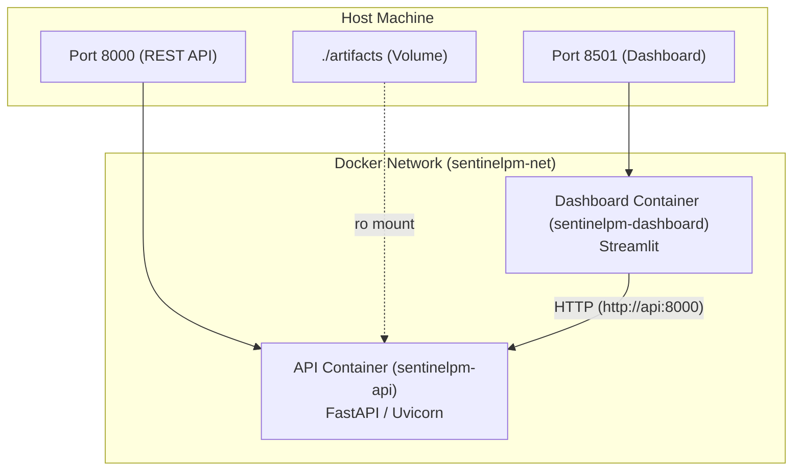

# SentinelPM — Docker Deployment Guide

## 1. Overview

SentinelPM is packaged as a lightweight, reproducible container ecosystem using Docker and Docker Compose. A single multi-purpose image (`sentinelpm:latest`) based on `python:3.11-slim` powers both the FastAPI prediction backend and the Streamlit industrial dashboard.



---

## 2. Container Design & Security Best Practices

- **Base Image:** `python:3.11-slim` ensures minimal image footprint (~450MB) and reduced attack surface.
- **Unprivileged User:** The container executes under `appuser` (UID 1000, non-root) to mitigate privilege escalation vulnerabilities.
- **Isolated Network:** Services communicate over an internal bridge network (`sentinelpm-net`). The dashboard communicates with the API via the service name `http://api:8000`.
- **Health Checks:** Built-in `HEALTHCHECK` periodically probes `GET /health` using `curl`. Docker Compose uses `condition: service_healthy` so the dashboard only starts once the API is verified live.
- **Data Protection:** The raw training dataset (`data/raw/`) is strictly excluded via `.dockerignore` to keep production containers lean and protect proprietary training corpora.

---

## 3. Quickstart Deployment Commands

### Prerequisites
- Docker Engine 24+ / Docker Desktop.
- Docker Compose v2+.

### Build and Launch Services

```bash
# 1. Build the unified Docker image
docker compose build

# 2. Start services in detached mode
docker compose up -d

# 3. Verify service health and port bindings
docker compose ps
```

### Accessing Endpoints

- **FastAPI Documentation:** [http://localhost:8000/docs](http://localhost:8000/docs)
- **FastAPI Health Probe:** [http://localhost:8000/health](http://localhost:8000/health)
- **Streamlit Industrial Dashboard:** [http://localhost:8501](http://localhost:8501)

### Inspecting Logs and Teardown

```bash
# View real-time logs from both containers
docker compose logs -f

# View logs for API only
docker compose logs -f api

# Stop and remove containers and network
docker compose down
```

---

## 4. Environment Configuration Reference

The following environment variables can be overridden in `docker-compose.yml` or through a `.env` file:

| Variable | Default (Container) | Purpose |
| --- | --- | --- |
| `SENTINELPM_ENVIRONMENT` | `prod` | Runtime profile (`dev`, `test`, `prod`) |
| `SENTINELPM_LOG_LEVEL` | `INFO` | Console log verbosity |
| `SENTINELPM_API_PORT` | `8000` | Port on which Uvicorn binds |
| `SENTINELPM_ACTIVE_MODEL` | `random_forest` | Target model architecture (`random_forest`, `xgboost`) |
| `SENTINELPM_API_URL` | `http://api:8000` | Target URL used by Streamlit to reach FastAPI |

---

## 5. Production Hardening Checklist

1. **TLS / Reverse Proxy:** In production, place NGINX, Traefik, or Caddy in front of ports 8000 and 8501 to provide HTTPS encryption and rate limiting.
2. **Artifact Backup:** Back up `./artifacts/models/` and `./artifacts/reports/` using encrypted object storage (e.g., S3 or GCS).
3. **Resource Constraints:** In production orchestrators (Kubernetes / Docker Swarm), set memory limits (recommended: 1GB per container) and CPU limits (1.0 core).
